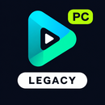

<p align="center"></p>

# Nuvio Legacy PC Audio

**LG won't play DTS or TrueHD? PC to the rescue.**

An independent, unofficial fork of [Nuvio Native Legacy](https://github.com/iqui27/nuvio-native-legacy), maintained by [ozggit](https://github.com/ozggit). It adds a Windows companion that converts unsupported movie audio to Dolby Digital, with up to 5.1 channels, while copying the video unchanged.

**Public alpha · LG webOS TV + Windows PC.** This edition is based on Nuvio Legacy 2.0.8. It is not an official NuvioMedia or upstream Legacy release, and is not endorsed by those projects. Credit for the original client and Nuvio ecosystem belongs to their authors.

[Download the alpha](https://github.com/ozggit/nuvio-native-legacy/releases/tag/pc-audio-2.0.85-alpha.1) · [Install and pair](docs/pc-audio/INSTALL.md) · [Report a problem](https://github.com/ozggit/nuvio-native-legacy/issues/new/choose) · [Build from source](docs/pc-audio/BUILD.md)

## What happens to your stream?

```text
Supported audio  ──────────────────────────────> LG TV

DTS / DTS-HD / TrueHD / MLP
       └──> Your PC: audio → Dolby Digital AC-3 ─> LG TV → soundbar / AVR
                     video → copied unchanged
```

- Browse and choose sources in Nuvio as usual. No new media library or wrapper add-on is needed.
- Known supported audio plays directly on the TV, even with the PC off.
- With PC fallback enabled, unsupported audio is handled by the paired PC. If LG omits every audio track, the PC can inspect the file instead of leaving the TV silent.
- Video is copied, not re-encoded. This alpha handles H.264 and HEVC video. Audio keeps up to six channels: 7.1 becomes 5.1; stereo stays stereo.
- Pair with a **four-digit code**. No long URL or key needs to be entered on the TV.
- The TV shows **PC audio fallback** while preparing/loading. **Back** cancels the PC session and opens the source list.
- When enabled, PC fallback takes priority over Legacy's local DTS converter. Turn it off to restore the original local conversion behavior.

The PC must stay awake and reachable while it handles a stream. Its page shows the selected audio, output channels and data sent.

## Downloads

| Component | Alpha version | Download |
|---|---|---|
| LG webOS app | 2.0.85 | [TV IPK](https://github.com/ozggit/nuvio-native-legacy/releases/download/pc-audio-2.0.85-alpha.1/space.nuvio.native.legacy.pcaudio_2.0.85_arm.ipk) |
| Windows companion | 0.2.1 | [Companion ZIP](https://github.com/ozggit/nuvio-native-legacy/releases/download/pc-audio-2.0.85-alpha.1/Nuvio-PC-Audio-Companion-0.2.1.zip) |

The companion currently needs **Node.js 22+ and FFmpeg/FFprobe on PATH**. A self-contained Windows installer/tray app is planned; it is not included in this alpha. Follow the [installation guide](docs/pc-audio/INSTALL.md) for dependencies, manual TV installation and pairing.

The TV app uses the separate ID `space.nuvio.native.legacy.pcaudio` and a **PC AUDIO** icon. It installs alongside the original Legacy app. Update an earlier PC Audio build in place to retain its local settings. This alpha uses manual updates from this fork's Releases page; it does not install upstream updates over itself.

## Alpha status and limits

Actual playback was confirmed with app 2.0.83: Nuvio displayed **AC-3 5.1**, and a Sonos system reported **Dolby Digital 5.1**. This is evidence for the tested stream, not a claim of compatibility with every LG model or source. The new 2.0.85 banner and Back-to-sources flow still need on-TV feedback.

- English main audio is preferred. Embedded subtitles and changing audio tracks are not supported in PC mode.
- AC-3 does not retain lossless audio or Atmos/DTS:X objects. Maximum output is 5.1.
- Source inspection and TV buffering add startup time. Seeking uses video keyframes; some sources cannot safely seek.
- HDR/Dolby Vision, high-bitrate remuxes, prolonged pauses and external-subtitle timing after seeking need broader device testing.
- PC fallback is for movies/episodes, not trailers or live channels.
- This release targets LG webOS with a Windows companion. Other platform code is inherited from upstream and is not a PC Audio release for those platforms.

Automated tests cover codec routing, real DTS/TrueHD conversion, copied video frames, seeking, headers, cancellation and pairing. [Validation and release notes](docs/pc-audio/RELEASE-2.0.85.md).

## Support, source and credits

Report PC Audio issues [in this fork](https://github.com/ozggit/nuvio-native-legacy/issues/new/choose). Include TV/companion versions, the codec and the visible error. Do not post pairing secrets, account tokens, private stream URLs or the companion's `data` folder. You do not need to send logs to the upstream project's diagnostic service to report a problem here.

The TV client retains upstream account/add-on integrations; this fork does not operate a replacement Nuvio account service. The companion handles audio locally on your PC/LAN.

This fork is distributed under [GNU GPLv3](LICENSE), with existing third-party notices retained. PC Audio modifications by ozggit, 7 November 2026: LAN companion protocol, four-digit pairing, audio fallback detection, PC status/cancellation UI and PC Audio branding. [Credits and source locations](docs/pc-audio/CREDITS.md) · [Archived upstream README](UPSTREAM-README.md).
